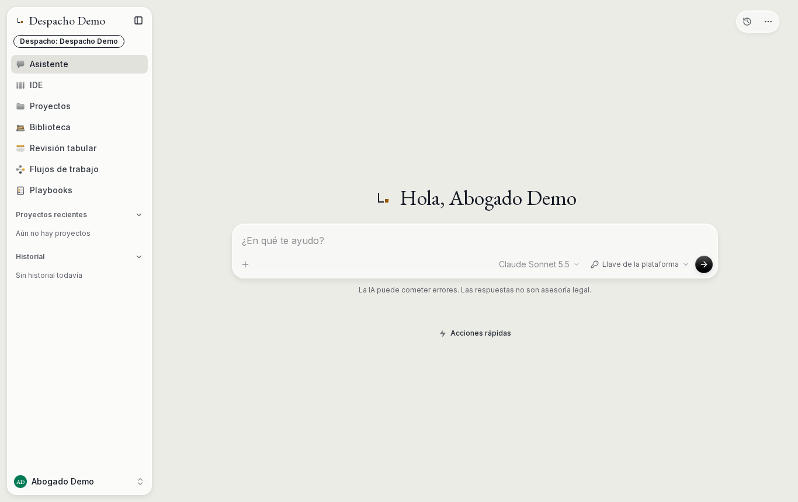
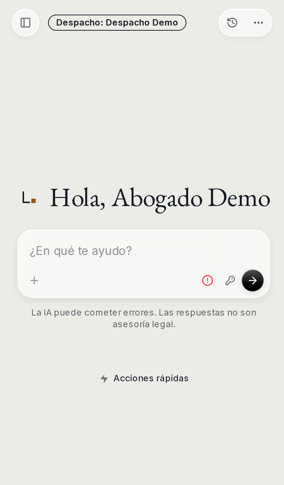

<p align="center">
  <picture>
    <source media="(prefers-color-scheme: dark)" srcset="docs/brand/svg/litt-wordmark-color-oscuro.svg">
    
  </picture>
</p>

# LiTT

LiTT is an AI workspace for law firms and legal departments in Mexico. It
supports document review, drafting, legal research and tabular review, and keeps
each firm's documents, matters and keys apart from every other firm's.

LiTT is derived from [MikeOSS](https://github.com/open-legal-products/mike). See
[Attribution](#attribution).

<p align="center">
  
</p>

## Status

LiTT is in **closed beta, by invitation only**. The hosted service at
<https://litt.asteroitt.com> is open to invited people and firms. To ask for
access, write to [soporte@asteroitt.com](mailto:soporte@asteroitt.com).

Issues are disabled on this repository. Questions go to the address above, and
code proposals go through pull requests. See [CONTRIBUTING.md](CONTRIBUTING.md).

## Features

- Chat about the documents in a matter or project.
- Review documents and apply suggested edits, with a version history for each document.
- Tabular review: ask the same questions of many documents and get one table.
- Reusable assistant and tabular-review workflows, and playbooks for common drafting tasks.
- Organize work into projects, matters and a document library. Private matters are limited to their members.
- Convert documents between Markdown, Word and PDF, and compare two Word documents; each result is a new document.
- Split a PDF that holds several documents into one file per document.
- Read scanned PDFs with an optional OCR key.
- Use LiTT from Microsoft Word with the task-pane add-in.
- Interface in Spanish (es-MX) and English (en-US).

<p align="center">
  
</p>

## Principles

- **Bring your own keys (BYOK).** Each person or firm uses its own model keys,
  set up in the app. LiTT does not fall back silently to another key or model.
- **No third-party telemetry.** No error reports or usage data are sent to
  third parties. Each process logs failures locally.
- **Source for every build (AGPL-3.0 §13).** Every build embeds its commit, and
  the **Código fuente** link in the app points to the exact source it runs.
- **Tenancy by firm.** Firms, workspaces and matters are separated by the
  database (row-level security) and by explicit membership for private matters.
  Audit and AI evidence records are append-only.

## Quick start (local, Docker Compose)

This starts LiTT with local Supabase-compatible auth and Postgres, object
storage and a local mail catcher. It uses synthetic data only and is not the
production setup.

Requirements: Git, Docker with Compose v2, and `openssl`. Node.js 22.19 or newer
is needed for the `npm run stack:*` scripts.

1. Clone the repository and copy the environment templates:

   ```bash
   git clone https://github.com/IvanJS17/litt.git
   cd litt
   cp .env.example .env
   cp backend/.env.example backend/.env
   ```

2. In `backend/.env`, set `DOWNLOAD_SIGNING_SECRET` and
   `USER_API_KEYS_ENCRYPTION_SECRET` to two different values, each generated with:

   ```bash
   openssl rand -hex 32
   ```

   The backend refuses to start if either one still holds the example
   placeholder or is shorter than 32 characters.

3. Optional: add an Anthropic, Gemini or OpenAI key to `backend/.env`. You can
   also add keys later in the app's Settings, or use Ollama without any cloud key
   (see [Local models with Ollama](docs/local-development.md#local-models-with-ollama)).

4. Start the stack:

   ```bash
   GIT_SHA=$(git rev-parse HEAD) docker compose up --build
   ```

   `GIT_SHA` is the full commit SHA the images embed for the **Código fuente**
   link (AGPL-3.0 §13). The images refuse to build without it.

5. Open [http://localhost:3000](http://localhost:3000) and create an account.
   Confirmation email is captured by Mailpit at
   [http://localhost:8025](http://localhost:8025).

To stop, run `npm run stack:down`. Do not use `docker compose stop`: stopped
containers are not removed on their own and keep images and volumes in use. Add
`-- --purge` to also delete the local data volumes. See
[Stop and clean up](docs/local-development.md#stop-and-clean-up).

The bundled credentials and infrastructure are for local development only.

## Documentation

- [Documentation index](docs/README.md)
- [Local development](docs/local-development.md)
- [Manual and production deployment](docs/deployment.md)
- [Troubleshooting](docs/troubleshooting.md)
- [Safe local testing](docs/safe-local-testing.md)
- [Microsoft Word add-in](docs/word-addin-development.md)
- [End-to-end testing and CI](docs/e2e-ci.md)
- [Project status](docs/PROJECT_STATUS.md)
- [Contributing](CONTRIBUTING.md)
- [Security policy](SECURITY.md)
- [Open-source credits](CREDITS.md)

Each production deployment is published as a
[GitHub release](https://github.com/IvanJS17/litt/releases) tagged
`prod-YYYYMMDDx`, which points to the commit that is running.

## Repository layout

| Path | Purpose |
| --- | --- |
| `frontend/` | Next.js web application |
| `backend/` | Express API, document processing and database access |
| `word-addin/` | Microsoft Word task-pane add-in |
| `packages/` | Code shared by the applications |
| `backend/schema.sql` | Complete schema for fresh databases |
| `backend/migrations/` | Dated migrations for existing databases |
| `docker-compose.yml` | Local application and infrastructure stack |
| `docs/` | Development, deployment, testing and feature guides |

## System workflows

The assistant's system workflows and tabular-review workflows are maintained in
the [`Open-Legal-Products/mike-workflows`](https://github.com/Open-Legal-Products/mike-workflows)
repository. See [Mike Workflows](CONTRIBUTING.md#mike-workflows) in CONTRIBUTING.md.

## Security

Report vulnerabilities privately through
[GitHub's private vulnerability reporting](https://github.com/IvanJS17/litt/security/advisories/new),
or by email to [soporte@asteroitt.com](mailto:soporte@asteroitt.com). Do not
open a public issue. See [SECURITY.md](SECURITY.md).

## Attribution

LiTT is a modified version of **MikeOSS** (`open-legal-products/mike`,
<https://github.com/open-legal-products/mike>), an open-source legal AI platform,
licensed under the GNU Affero General Public License v3.0 only (AGPL-3.0-only).
The MikeOSS copyright notices and the license are kept in this repository.

LiTT adds the changes for Mexican legal practice and firm use, and is maintained
by Iván Juárez Soria. LiTT is not an official MikeOSS release. Third-party
projects used by LiTT are listed in [CREDITS.md](CREDITS.md).

## License

LiTT is licensed under the [GNU Affero General Public License v3.0 only](LICENSE)
(AGPL-3.0-only).

## En español

LiTT es un espacio de trabajo con IA para despachos y áreas jurídicas en México.
Permite consultar documentos, revisarlos, redactar, investigar y hacer revisiones
tabulares, con los documentos, asuntos y llaves de cada despacho separados de los
demás.

- **Estado:** beta cerrada, por invitación, en <https://litt.asteroitt.com>.
  Para pedir acceso: [soporte@asteroitt.com](mailto:soporte@asteroitt.com).
- **Principios:** cada persona o despacho usa sus propias llaves de IA (BYOK), sin
  respaldo silencioso a otra llave o modelo; sin telemetría a terceros; cada build
  enlaza al código fuente exacto que ejecuta (AGPL-3.0 §13).
- **Local:** sigue el [inicio rápido](#quick-start-local-docker-compose) con Docker
  Compose; usa solo datos sintéticos.
- **Atribución:** LiTT es una versión modificada de MikeOSS
  (`open-legal-products/mike`), con licencia AGPL-3.0-only. Ver
  [Atribución](#attribution).
- **Contribuir:** por pull request; los issues están desactivados. Ver
  [CONTRIBUTING.md](CONTRIBUTING.md).
